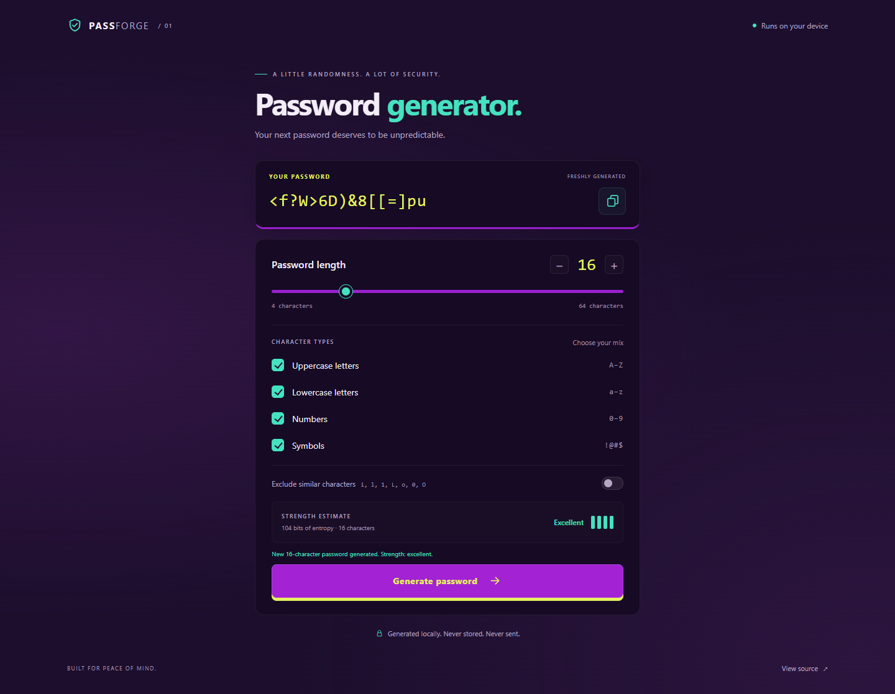

# Passforge · Password Generator

A focused password generator with a purple, mint, and lime interface. Built with semantic HTML, CSS, and JavaScript, with no runtime dependencies.

[Open the live app](https://the-jj1.github.io/password-generator/) · [How generation works](#security-and-privacy) · [Development](#development)



## Features

- Generate passwords from 4 to 64 characters; the default is 16.
- Mix uppercase letters, lowercase letters, numbers, and symbols. Every selected group is guaranteed to appear.
- Optionally exclude ambiguous characters: `i`, `l`, `1`, `L`, `o`, `0`, `O`.
- Copy with one click; manual selection remains available if clipboard access is denied.
- See a strength estimate based on the actual generated password search space.
- Use a keyboard, screen reader, touch screen, or reduced-motion preference.
- Work locally with no tracking, external fonts, password history, or backend.

## Security and privacy

Randomness comes exclusively from [`crypto.getRandomValues()`](https://www.w3.org/TR/webcrypto/#Crypto-method-getRandomValues). Rejection sampling discards out-of-range byte values to avoid modulo bias. Full candidate passwords are rejected unless they include every selected group. This keeps the distribution uniform over all valid strings, rather than biasing it by inserting mandatory characters.

The strength display uses inclusion-exclusion to count valid strings, then computes `log2(count)`. Labels are Weak below 40 bits, Fair below 60, Strong below 80, and Excellent from 80 bits. This is a search-space estimate for this generator, not a guarantee about an account or a prediction of cracking time. Short passwords remain available for compatibility; use longer, unique passwords for real accounts.

Generated passwords stay in page memory until replaced, settings change, or the page closes. The app does not use cookies, local storage, session storage, analytics, or network requests during generation. Copying places the password on the system clipboard, which is managed by your device and other applications. No automatic clipboard clearing is promised.

If Web Crypto is unavailable, generation fails with a visible error. There is no fallback to `Math.random()`. The site has a restrictive Content Security Policy, and deployment publishes only the app files. Hosting providers still receive normal page and asset requests. Serve over HTTPS or localhost; clipboard APIs require a secure context.

## Development

Requires Node.js 22 or newer. Node.js 24 is used in CI.

```sh
npm ci
npm start
```

Open [localhost:4173](http://127.0.0.1:4173). The local server binds to loopback and serves only public application files. Set `PORT` to use another port.

```sh
npm run check       # JavaScript syntax checks
npm test            # Generator and entropy tests
npx playwright install chromium
npm run test:e2e    # Real browser interaction and privacy tests
npm run build       # Creates dist/ for any static host
```

For a locally installed Chrome, set `PW_CHANNEL=chrome` before running browser tests. Playwright is a development dependency; the deployed app downloads no packages.

## Project layout

```text
index.html               Semantic interface and metadata
src/generator.js         Secure random sampling and entropy calculation
src/app.js               Interaction, validation, clipboard, and feedback
src/styles.css           Responsive interface and focus states
src/theme.css            Shared color tokens
tests/                   Node.js unit tests
e2e/                     Playwright browser tests
scripts/                 Local server and static build
.github/workflows/       Quality checks and GitHub Pages deployment
```

## Deployment

The repository includes a [GitHub Pages workflow](.github/workflows/pages.yml). In repository **Settings → Pages → Build and deployment**, choose **GitHub Actions**. Each push to `main` verifies the generator, builds `dist/`, and deploys that folder. The separate quality workflow also runs the browser suite. Relative asset URLs support deployment under a repository path.

To host elsewhere, upload the contents of `dist/` to an HTTPS static host. No environment variables or secrets are needed.

## License

[MIT](LICENSE) · Copyright 2026 The-Jj1.
